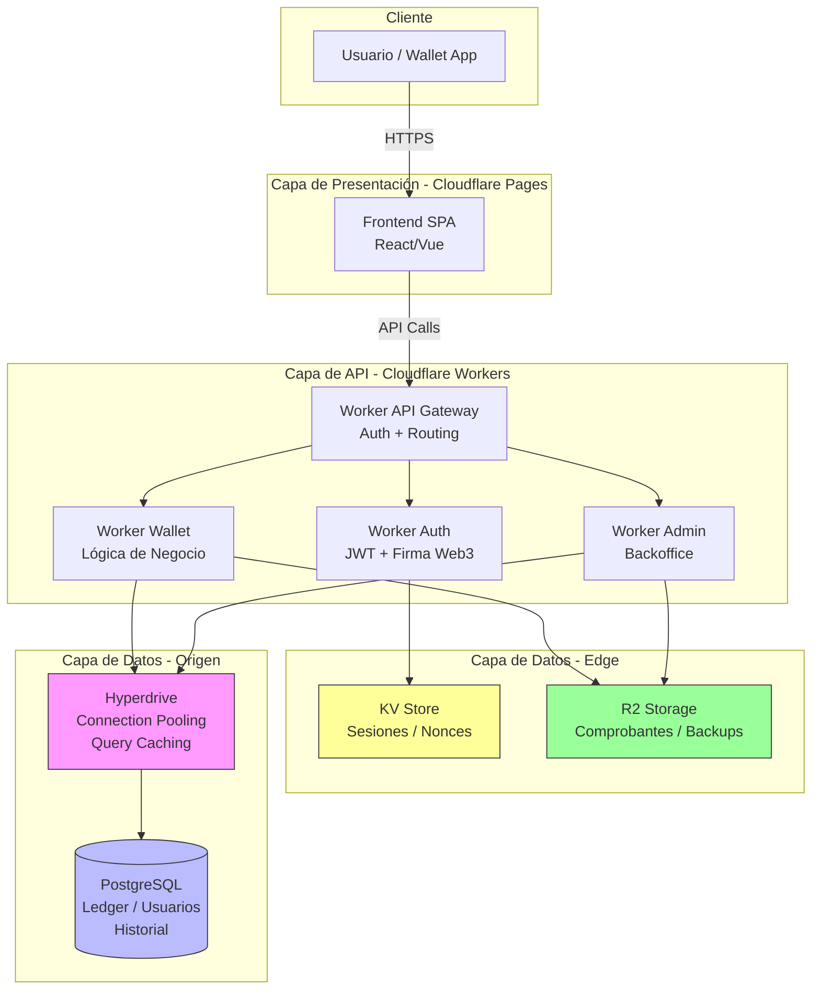
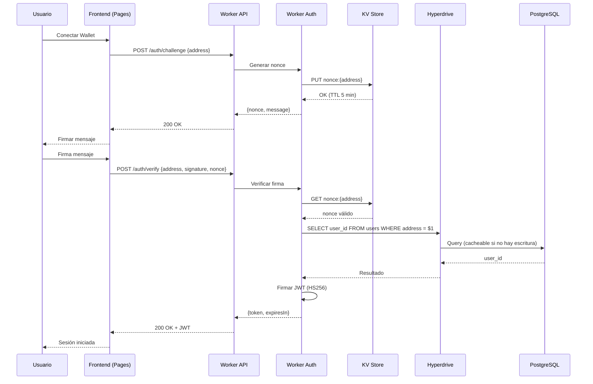
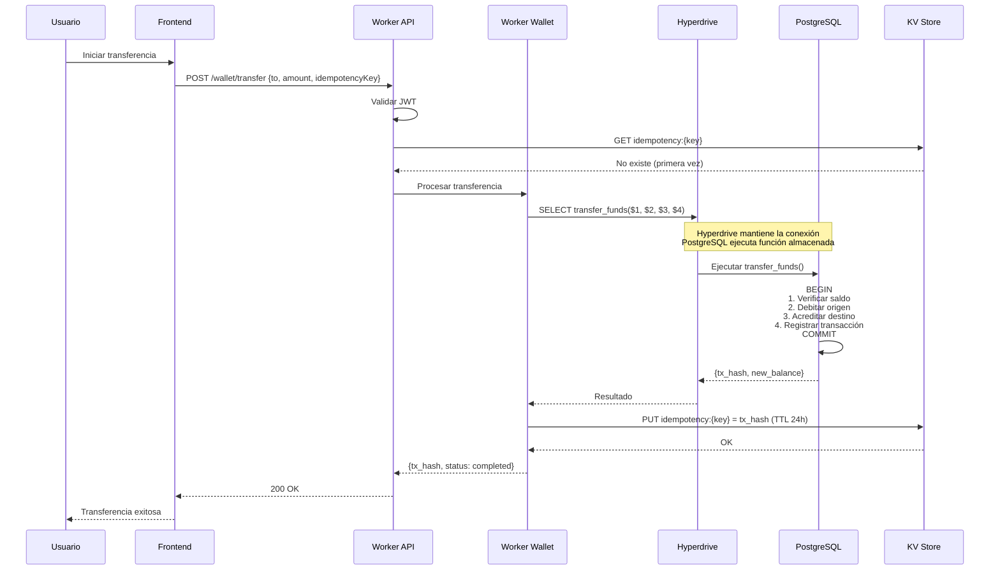
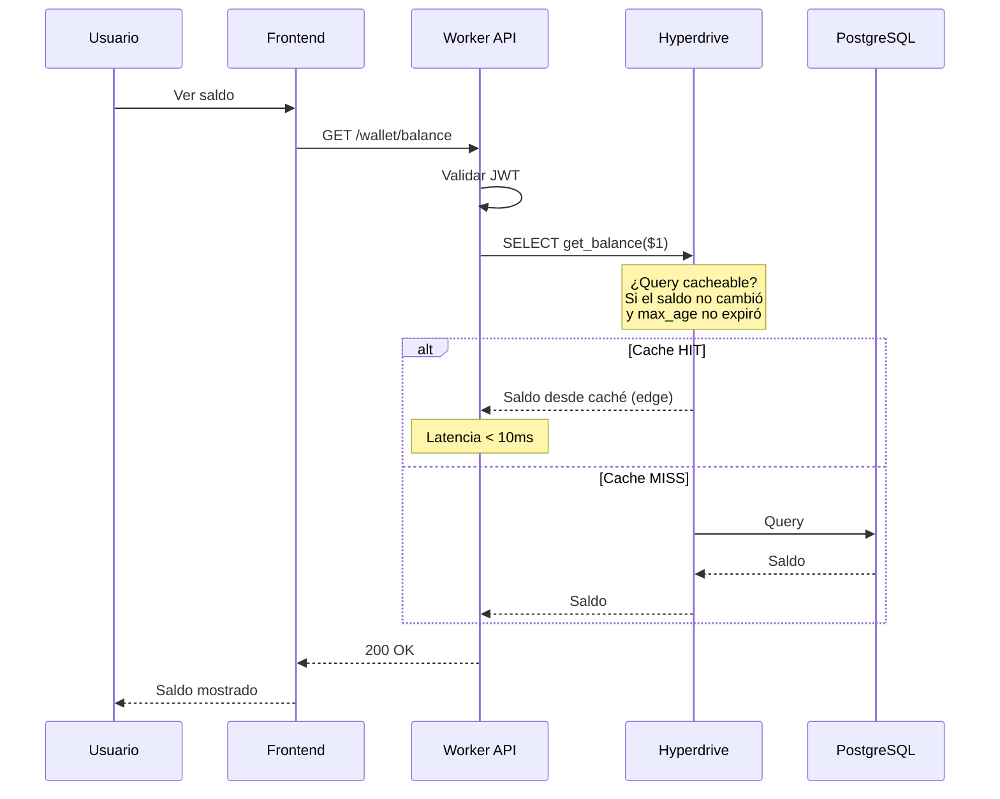
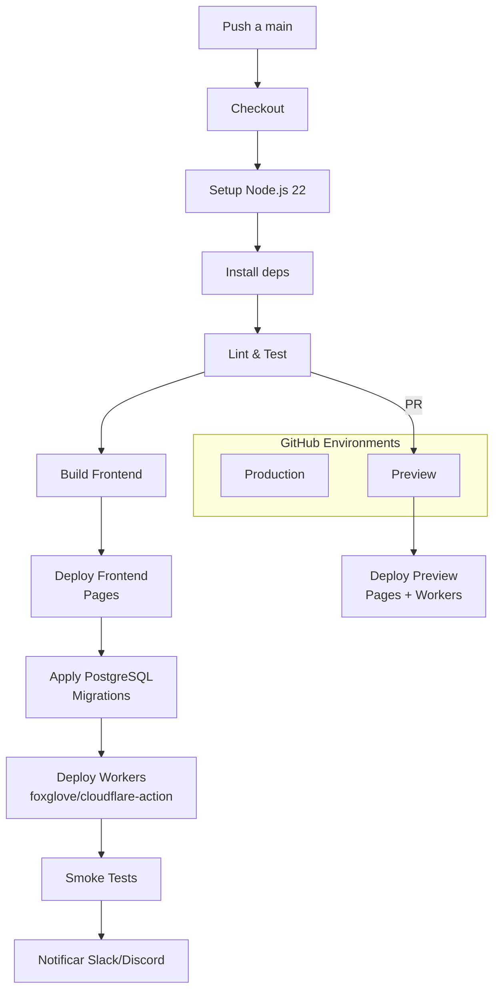

# Auditoría Técnica Integral — Wallet MVP en Cloudflare

**Versión:** 2.0  
**Fecha:** 2026-09-29  
**Responsable:** Equipo DevOps / Auditoría Externa  
**Alcance:** Backend (Workers, PostgreSQL, Hyperdrive, KV, R2), Frontend (Pages), Base de Datos (PostgreSQL) y CI/CD (GitHub Actions).

---

## 1. Propósito y Alcance

Esta auditoría evalúa el estado actual de la wallet MVP construida sobre Cloudflare, abarcando **backend, frontend y base de datos**, con el objetivo de:

- Estimar el porcentaje de avance hacia un MVP listo para usuarios limitados.
- Identificar brechas técnicas, de seguridad y de arquitectura.
- Priorizar mejoras críticas (P0) antes de escalar.
- Alinear el código existente con la arquitectura de referencia definida.

**Incluye:** Estructura del código, configuración de Workers, conexión a PostgreSQL vía Hyperdrive, seguridad y autenticación, lógica de negocio, uso de KV/R2, frontend en Cloudflare Pages, pipeline CI/CD, y observabilidad.

**Fuera de alcance:** Pruebas de penetración externas y auditoría legal/regulatoria.

---

## 2. Arquitectura de Referencia (Baseline)

Cualquier desviación significativa respecto a esta arquitectura será señalada como brecha.

### 2.1 Diagrama General



### 2.2 Decisiones Clave de la Arquitectura

1. **PostgreSQL es el Single Source of Truth (SSOT).** No se migra a D1.
2. **Hyperdrive es obligatorio** para connection pooling y caché de consultas.
3. **No se usan Durable Objects.** La consistencia se garantiza con transacciones ACID en PostgreSQL.
4. **KV solo para sesiones, nonces e idempotencia.** Límite: 1,000 escrituras/día.
5. **R2 para comprobantes y backups.** Sin costo de egress.
6. **Workers como orquestadores ligeros.** La lógica pesada vive en funciones almacenadas de PostgreSQL. CPU time límite: 10 ms por invocación en free tier.
7. **Cloudflare Pages sirve el frontend** con CDN global, HTTPS automático y continuous deployment desde Git.
8. **CI/CD con GitHub Actions.** Se recomienda `foxglove/cloudflare-action` por su soporte nativo de preview deployments y GitHub Deployments integration.

### 2.3 Flujo de Autenticación



### 2.4 Flujo de Transacción (Transferencia)



### 2.5 Flujo de Consulta de Saldo



### 2.6 Pipeline CI/CD



**Workflow de referencia (`.github/workflows/deploy.yml`):**

```yaml
name: Deploy Wallet
on:
  push:
    branches: [main]
  pull_request:

permissions:
  contents: read
  deployments: write

jobs:
  test:
    runs-on: ubuntu-latest
    steps:
      - uses: actions/checkout@v4
      - uses: actions/setup-node@v4
        with: { node-version: 22 }
      - run: npm ci
      - run: npm run lint && npm test

  deploy:
    needs: test
    runs-on: ubuntu-latest
    steps:
      - uses: actions/checkout@v4
      - run: npm ci && npm run build
      - uses: foxglove/cloudflare-action@v1
        with:
          type: pages
          apiToken: ${{ secrets.CLOUDFLARE_API_TOKEN }}
          accountId: ${{ secrets.CLOUDFLARE_ACCOUNT_ID }}
          projectName: wallet-frontend
          directory: dist
          gitHubToken: ${{ secrets.GITHUB_TOKEN }}
      - name: Apply PostgreSQL migrations
        if: github.ref == 'refs/heads/main'
        run: psql ${{ secrets.DATABASE_URL }} -f migrations/*.sql
      - uses: foxglove/cloudflare-action@v1
        with:
          type: workers
          apiToken: ${{ secrets.CLOUDFLARE_API_TOKEN }}
          accountId: ${{ secrets.CLOUDFLARE_ACCOUNT_ID }}
          gitHubToken: ${{ secrets.GITHUB_TOKEN }}
```

---

## 3. Metodología de Auditoría

### 3.1 Escala de Evaluación

Cada pregunta se responde con:

- ✅ **Sí** = 1 punto
- ⚠️ **Parcial** = 0.5 puntos
- ❌ **No** = 0 puntos
- N/A = se excluye del denominador

### 3.2 Pesos por Dominio

| Bloque | Peso |
|--------|------|
| A. Backend — Arquitectura y Estructura | 10% |
| B. Backend — Cloudflare Workers Config | 10% |
| C. Backend — PostgreSQL + Hyperdrive | 15% |
| D. Backend — Seguridad y Autenticación | 15% |
| E. Backend — Lógica de Negocio | 10% |
| F. Backend — KV, R2 | 5% |
| G. Frontend — Cloudflare Pages | 15% |
| H. Base de Datos — Esquema y Rendimiento | 10% |
| I. CI/CD y Despliegue | 5% |
| J. Observabilidad | 5% |
| **Total** | **100%** |

---

## 4. BLOQUE A — Backend: Arquitectura y Estructura del Código (Peso: 10%)

| # | Pregunta | Cómo evaluar |
|---|----------|--------------|
| A.1 | ¿Existe una separación clara entre Workers (API Gateway, Auth, Wallet, Admin) o todo está en un solo Worker monolítico? | Revisar `wrangler.toml` y estructura de carpetas. Lo ideal: múltiples Workers o al menos módulos separados. |
| A.2 | ¿El código está modularizado (servicios, handlers, repositorios) o hay lógica mezclada en un solo archivo? | Buscar archivos de +500 líneas. Señal de alerta. |
| A.3 | ¿Existe una capa de acceso a datos separada de la lógica de negocio? | Debe haber un `repository` o `db` layer que encapsule las queries. |
| A.4 | ¿Se usan tipos (TypeScript) o el proyecto es JavaScript puro sin tipos? | TypeScript estricto es lo recomendado para wallets. |
| A.5 | ¿Hay un archivo de configuración centralizado (env vars, constantes) o están hardcodeados valores? | Buscar strings de conexión, claves, URLs hardcodeadas. |
| A.6 | ¿Existe documentación mínima (README, comentarios en funciones críticas)? | Un README con arquitectura y setup es lo mínimo. |
| A.7 | ¿El proyecto usa un linter/formatter (ESLint, Prettier)? | Revisar `.eslintrc`, `prettier.config`, scripts en `package.json`. |

**Señales de alerta:** lógica de negocio en el handler HTTP, queries SQL concatenadas, secretos en el código, archivos monolíticos.

---

## 5. BLOQUE B — Backend: Cloudflare Workers Config y Límites (Peso: 10%)

| # | Pregunta | Cómo evaluar |
|---|----------|--------------|
| B.1 | ¿`wrangler.toml` tiene `compatibility_flags = ["nodejs_compat"]`? | **Requerido** para drivers de PostgreSQL. |
| B.2 | ¿El Worker está configurado con `compatibility_date` reciente (2024+)? | Fechas viejas pueden tener comportamiento legacy. |
| B.3 | ¿Se monitorea el CPU time por invocación? ¿Está por debajo de 10 ms? | Revisar Workers Analytics. Si supera 10 ms, el request falla en free tier. El promedio de un Worker es ~2.2 ms, pero cargas con autenticación pueden llegar a 10-20 ms. |
| B.4 | ¿El Worker hace más de 3 subrequests por invocación? | Límite free: 50 subrequests. Más de 3 es sospechoso. |
| B.5 | ¿Hay lógica pesada (bucles, procesamiento de JSON grande, criptografía) en el Worker? | Debe moverse a PostgreSQL o a funciones auxiliares. |
| B.6 | ¿Se usa `ctx.waitUntil()` para operaciones no bloqueantes (logs, métricas)? | Correcto uso evita bloquear la respuesta. |
| B.7 | ¿El Worker maneja errores con try/catch y devuelve códigos HTTP correctos? | Revisar que no devuelva 200 en errores. |
| B.8 | ¿Existe un manejo de CORS restrictivo (no `*` en producción)? | Revisar headers `Access-Control-Allow-Origin`. |

**Señales de alerta:** CPU time > 10 ms, múltiples subrequests, CORS abierto, ausencia de manejo de errores.

---

## 6. BLOQUE C — Backend: PostgreSQL + Hyperdrive (Peso: 15%)

| # | Pregunta | Cómo evaluar |
|---|----------|--------------|
| C.1 | ¿Hyperdrive está configurado y vinculado al Worker? | Revisar binding `HYPERDRIVE` en `wrangler.toml` o `wrangler.jsonc`. |
| C.2 | ¿El Worker se conecta a PostgreSQL usando `env.HYPERDRIVE.connectionString`? | **Nunca** debe usarse la connection string original de la DB en el Worker. |
| C.3 | ¿Se usa un driver compatible con Workers (`pg` o `postgres.js`)? | Verificar `package.json`. |
| C.4 | ¿Las operaciones críticas (transferencias, débitos) usan **funciones almacenadas** en PostgreSQL? | Buscar `SELECT transfer_funds(...)`. Si la lógica está en el Worker, es un problema. |
| C.5 | ¿Las transacciones usan `BEGIN` / `COMMIT` / `ROLLBACK` correctamente? | Revisar funciones almacenadas o queries del Worker. |
| C.6 | ¿Las queries usan parámetros preparados ($1, $2) y no concatenación de strings? | **Crítico** para prevenir SQL injection. |
| C.7 | ¿Se cierran las conexiones después de cada query? | El no hacerlo agota el pool y causa `EMAXCONNSESSION`. |
| C.8 | ¿Se monitorea el número de conexiones simultáneas vs. `origin_connection_limit`? | Si Hyperdrive intenta abrir más conexiones de las que el pooler permite, las conexiones se rechazan. |
| C.9 | ¿Se monitorea el número de consultas a Hyperdrive (límite 10M/mes)? | Revisar dashboard de Cloudflare. |
| C.10 | ¿Se ha verificado que Hyperdrive puede conectar a la DB (test connection)? | Hyperdrive realiza una conexión de prueba en background antes de crear/actualizar la configuración. |
| C.11 | ¿Los errores de la DB se manejan explícitamente y no se exponen al usuario? | **Nunca** exponer errores de DB a usuarios. |
| C.12 | ¿Se usa TLS para la conexión a producción? | **Nunca** omitir TLS para DBs de producción. |

**Señales de alerta:** lógica de negocio en el Worker, queries concatenadas, connection string original en código, conexiones no cerradas, pool exhaustion.

---

## 7. BLOQUE D — Backend: Seguridad y Autenticación (Peso: 15%)

| # | Pregunta | Cómo evaluar |
|---|----------|--------------|
| D.1 | ¿La autenticación usa firmas Web3 (EIP-191 / EIP-712) además de JWT? | Para wallet, lo ideal es firma + JWT. |
| D.2 | ¿Los nonces se generan aleatoriamente y se almacenan en KV con TTL? | Revisar `crypto.randomUUID()` o similar, y TTL de 5 min. |
| D.3 | ¿Los nonces se invalidan después de usarse (anti-replay)? | Si se reutilizan, hay vulnerabilidad. |
| D.4 | ¿El JWT está firmado con HS256 o RS256 y tiene expiración (`exp`)? | Revisar payload del token. |
| D.5 | ¿Los secretos (JWT_SECRET, DATABASE_URL) están en `wrangler secret` o GitHub Secrets? | **Nunca** en el código ni en `.env` commiteado. |
| D.6 | ¿Hay rate limiting en endpoints críticos (login, transfer)? | Implementado con KV, DO o Cloudflare Rate Limiting. |
| D.7 | ¿Se valida el input del usuario (address, amount, signature)? | Revisar validación de formato, longitud, tipo. |
| D.8 | ¿Hay límites de gasto por transacción y por día? | Crítico para prevenir "denial-of-wallet". |
| D.9 | ¿Existe una allow-list de direcciones destino o se permite cualquier destino? | Para MVP, al menos un límite de monto. |
| D.10 | ¿Se registran intentos fallidos de autenticación? | Para detección de ataques. |
| D.11 | ¿El CORS está restringido a dominios específicos? | No `*`. |
| D.12 | ¿Hay protección contra replay attacks en transferencias? | Idempotency keys + nonces. |
| D.13 | ¿Se auditan los accesos al backoffice (Admin Worker)? | Cloudflare Access o similar. |
| D.14 | ¿Se ha ejecutado `npm audit` o `snyk test` sobre las dependencias? | Para detectar vulnerabilidades en paquetes externos. |
| D.15 | ¿Las variables de entorno están configuradas en Cloudflare (no en el código)? | Revisar el dashboard de Workers. |

**Señales de alerta:** secretos en código, sin rate limiting, sin validación de input, JWT sin expiración, nonces reutilizables, CORS abierto.

---

## 8. BLOQUE E — Backend: Lógica de Negocio (Peso: 10%)

| # | Pregunta | Cómo evaluar |
|---|----------|--------------|
| E.1 | ¿Las transferencias son atómicas (todo o nada)? | Debe usar transacción PostgreSQL. |
| E.2 | ¿Se verifica el saldo antes de debitar? | Revisar función almacenada. |
| E.3 | ¿Hay idempotencia en transferencias (idempotency key)? | Si el usuario reintenta, no debe duplicar. |
| E.4 | ¿Se registra cada transacción en un ledger inmutable? | Tabla `transactions` con timestamp, hash, from, to, amount. |
| E.5 | ¿Hay un mecanismo de reconciliación (saldo calculado vs saldo almacenado)? | Importante para detectar inconsistencias. |
| E.6 | ¿Se manejan condiciones de carrera (race conditions)? | PostgreSQL con `SERIALIZABLE` o `SELECT ... FOR UPDATE`. |
| E.7 | ¿Hay límites de monto por transacción? | Configurable, pero debe existir. |
| E.8 | ¿Se notifica al usuario de transacciones exitosas/fallidas? | Webhook, email o push. |
| E.9 | ¿Se registran los errores de negocio (saldo insuficiente, dirección inválida)? | Para auditoría. |
| E.10 | ¿Hay un mecanismo de rollback si falla la notificación post-transacción? | O se usa `waitUntil` o se desacopla con colas. |

**Señales de alerta:** transferencias no atómicas, sin idempotencia, sin ledger, sin manejo de concurrencia.

---

## 9. BLOQUE F — Backend: KV, R2 y Almacenamiento Auxiliar (Peso: 5%)

| # | Pregunta | Cómo evaluar |
|---|----------|--------------|
| F.1 | ¿KV se usa solo para lecturas frecuentes y escrituras mínimas? | Límite: 1,000 escrituras/día, 100,000 lecturas/día, 1 GB almacenamiento. |
| F.2 | ¿Las escrituras en KV están concentradas en login/nonces? | Si hay escrituras en cada request, es un problema. |
| F.3 | ¿R2 se usa para comprobantes, backups o archivos? | Revisar bucket y objetos. |
| F.4 | ¿Los objetos en R2 tienen nombres predecibles y organizados? | Ej. `receipts/{tx_hash}.pdf`. |
| F.5 | ¿Hay una estrategia de limpieza de KV (TTL en nonces, sesiones)? | Evitar acumulación infinita. |
| F.6 | ¿Se monitorea el uso de KV y R2? | Dashboard de Cloudflare. |

---

## 10. BLOQUE G — Frontend: Cloudflare Pages (Peso: 15%)

### 10.1 Configuración de Seguridad

Cloudflare Pages **no proporciona** security headers por defecto. Un sitio con configuración por defecto obtiene una calificación **F** en auditorías de security headers.

| # | Pregunta | Cómo evaluar |
|---|----------|--------------|
| G.1 | ¿Existe un archivo `_headers` en el directorio de salida del build? | Si no existe, no se envían security headers. |
| G.2 | ¿Se incluye `Content-Security-Policy (CSP)` con directivas restrictivas? | **La CSP es la defensa más efectiva contra XSS.** Debe incluir `default-src 'self'`, `frame-ancestors 'none'`, `base-uri 'self'`, `form-action 'self'`. |
| G.3 | ¿Se incluye `X-Frame-Options: DENY`? | Previene clickjacking. |
| G.4 | ¿Se incluye `X-Content-Type-Options: nosniff`? | Previene MIME sniffing. |
| G.5 | ¿Se incluye `Referrer-Policy: strict-origin-when-cross-origin`? | Controla información de referrer. |
| G.6 | ¿Se incluye `Permissions-Policy` restrictiva? | Ej. `camera=(), microphone=(), geolocation=(), payment=()`. |
| G.7 | ¿Se incluye `Strict-Transport-Security (HSTS)`? | Para forzar HTTPS. |
| G.8 | ¿Se incluyen headers `Cross-Origin-*` (COOP, CORP, COEP)? | Previenen que el sitio sea embebido o que sus recursos sean cargados por páginas maliciosas. |
| G.9 | ¿Se ha verificado que la CSP no usa `'unsafe-inline'` en `script-src`? | El 71% de los sitios con CSP usan `'unsafe-inline'`, negando la protección XSS. |
| G.10 | ¿Se ha escaneado el sitio con una herramienta de auditoría de headers (ej. ZeriFlow, SecurityHeaders.com)? | Para validar la configuración. |

**Ejemplo de `_headers` para producción:**

```
/*
  X-Frame-Options: DENY
  X-Content-Type-Options: nosniff
  Referrer-Policy: strict-origin-when-cross-origin
  Permissions-Policy: camera=(), microphone=(), geolocation=(), payment=()
  X-XSS-Protection: 0
  Cross-Origin-Opener-Policy: same-origin
  Cross-Origin-Resource-Policy: same-origin
  Cross-Origin-Embedder-Policy: require-corp
  Content-Security-Policy: default-src 'self'; script-src 'self' https://static.cloudflareinsights.com; style-src 'self' 'unsafe-inline'; img-src 'self' data: https:; font-src 'self'; connect-src 'self' https://cloudflareinsights.com; frame-ancestors 'none'; base-uri 'self'; form-action 'self'; upgrade-insecure-requests

/assets/*
  Cache-Control: public, max-age=31536000, immutable

/*.html
  Cache-Control: public, max-age=0, must-revalidate
```

### 10.2 Rendimiento y Build

| # | Pregunta | Cómo evaluar |
|---|----------|--------------|
| G.11 | ¿El build de producción está optimizado (code splitting, tree shaking)? | Revisar bundle size con `source-map-explorer` o similar. |
| G.12 | ¿Se ha verificado que el bundle no expone claves de API o secretos? | Buscar en el bundle por strings de conexión, tokens, etc. |
| G.13 | ¿Se usa un CDN para assets estáticos (fuentes, imágenes)? | Cloudflare Pages sirve assets desde su CDN global. |
| G.14 | ¿Se ha verificado el SPA fallback (rutas que no son archivos devuelven `index.html`)? | Revisar `_redirects` o configuración del framework. |
| G.15 | ¿Se monitorea el número de builds mensuales (límite: 500 builds/mes en free)? | Dashboard de Cloudflare Pages. |
| G.16 | ¿Se ha verificado que el frontend desplegado sirve exactamente el bundle que se construyó localmente? | Comparar hashes de los chunks JS entre build local y producción. |

### 10.3 Preview Deployments y Control de Acceso

| # | Pregunta | Cómo evaluar |
|---|----------|--------------|
| G.17 | ¿Los preview deployments están protegidos con acceso restringido? | Cloudflare Access o protección por branch. |
| G.18 | ¿Se han configurado dominios personalizados con HTTPS forzado? | Cloudflare no redirige HTTP a HTTPS automáticamente para dominios personalizados. |
| G.19 | ¿Se ha verificado que los preview deployments no exponen datos de producción? | Los previews no deben conectarse a la DB de producción. |

---

## 11. BLOQUE H — Base de Datos: Esquema y Rendimiento (Peso: 10%)

| # | Pregunta | Cómo evaluar |
|---|----------|--------------|
| H.1 | ¿Existen índices en columnas de búsqueda frecuente (address, user_id, tx_hash, idempotency_key)? | Revisar el esquema. Un ledger sin índices degrada con el tiempo. |
| H.2 | ¿El esquema tiene constraints (FK, UNIQUE, NOT NULL, CHECK)? | Un ledger sin constraints es peligroso. |
| H.3 | ¿Hay migraciones versionadas (carpeta `migrations/`)? | Sin migraciones, los cambios de esquema son manuales y frágiles. |
| H.4 | ¿Se ha verificado que la DB no está en un pooler con `pool_size` menor al `origin_connection_limit` de Hyperdrive? | Esta discrepancia causa `EMAXCONNSESSION` y conexiones rechazadas. |
| H.5 | ¿Se monitorea el número de conexiones activas vs. el límite del pooler? | `SELECT count(*) FROM pg_stat_activity WHERE application_name = 'postgres.js'`. |
| H.6 | ¿Se ha verificado la versión del servidor PostgreSQL y su compatibilidad con Hyperdrive? | Revisar documentación de Hyperdrive para versiones soportadas. |
| H.7 | ¿Existe una estrategia de backups de PostgreSQL? | R2, `pg_dump` programado, o servicio gestionado. |
| H.8 | ¿Las funciones almacenadas usan `SECURITY DEFINER` o `SECURITY INVOKER` correctamente? | Revisar permisos de ejecución. |
| H.9 | ¿Se ha verificado que las queries cacheables por Hyperdrive usan funciones `IMMUTABLE` o `STABLE`? | Hyperdrive cachea reads pero requiere opt-in por query. |
| H.10 | ¿Se monitorea el tamaño de la DB y el crecimiento de tablas (transactions)? | Dashboard de PostgreSQL o queries periódicas. |

---

## 12. BLOQUE I — CI/CD y Despliegue (Peso: 5%)

| # | Pregunta | Cómo evaluar |
|---|----------|--------------|
| I.1 | ¿Existe un workflow de GitHub Actions para deploy? | Revisar `.github/workflows/`. |
| I.2 | ¿Se usa `foxglove/cloudflare-action` (recomendado) o `cloudflare/wrangler-action`? | `foxglove/cloudflare-action` ofrece preview deployments nativos, GitHub Deployments integration, y deploy retries. |
| I.3 | ¿Hay entornos separados (preview, staging, production)? | Revisar `wrangler.toml` y GitHub Environments. |
| I.4 | ¿Las migraciones de PostgreSQL se aplican automáticamente antes del deploy? | Paso en el workflow. |
| I.5 | ¿Hay tests automatizados (unitarios, integración)? | Al menos tests de funciones críticas. |
| I.6 | ¿El deploy requiere aprobación manual para producción? | GitHub Environments con reviewers. |
| I.7 | ¿Hay smoke tests después del deploy? | Verificar health check. |
| I.8 | ¿Se notifica el resultado del deploy (Slack, Discord, email)? | Para visibilidad del equipo. |
| I.9 | ¿Los secretos están en GitHub Secrets, no en el repo? | Revisar `.gitignore` y secrets. |
| I.10 | ¿Hay rollback automatizado o manual documentado? | Procedimiento claro. |

---

## 13. BLOQUE J — Observabilidad y Monitoreo (Peso: 5%)

| # | Pregunta | Cómo evaluar |
|---|----------|--------------|
| J.1 | ¿Se usa Workers Analytics para monitorear CPU, requests, errores? | Dashboard de Cloudflare. |
| J.2 | ¿Hay logs estructurados (JSON) en el Worker? | `console.log` con contexto. |
| J.3 | ¿Se usa un servicio de error tracking (Sentry, Bugsnag)? | Free tier de Sentry es suficiente. |
| J.4 | ¿Hay alertas configuradas para errores 5xx o límites de CPU? | Cloudflare Notifications. |
| J.5 | ¿Se monitorea el uso de Hyperdrive (consultas/mes)? | Dashboard de Cloudflare. |
| J.6 | ¿Hay un health check endpoint? | `/health` que devuelva 200. |
| J.7 | ¿Se monitorea el uso de KV (escrituras/día)? | Crítico por el límite de 1,000. |
| J.8 | ¿Se monitorea el uso de Pages (builds/mes)? | Límite: 500 builds/mes en free. |
| J.9 | ¿Hay un dashboard de métricas de negocio (transacciones, usuarios)? | Al menos queries en PostgreSQL. |
| J.10 | ¿Se monitorean los errores de conexión a la DB (EMAXCONNSESSION, pool exhaustion)? | Logs de Hyperdrive y PostgreSQL. |

---

## 14. Tabla de Puntuación Global

| Bloque | Peso | Preguntas | Puntaje Obtenido | Puntaje Máximo | % del Bloque |
|--------|------|-----------|------------------|----------------|--------------|
| A. Backend — Arquitectura | 10% | 7 | ___ | 7 | ___ |
| B. Backend — Workers Config | 10% | 8 | ___ | 8 | ___ |
| C. Backend — PostgreSQL + Hyperdrive | 15% | 12 | ___ | 12 | ___ |
| D. Backend — Seguridad | 15% | 15 | ___ | 15 | ___ |
| E. Backend — Lógica de Negocio | 10% | 10 | ___ | 10 | ___ |
| F. Backend — KV, R2 | 5% | 6 | ___ | 6 | ___ |
| G. Frontend — Cloudflare Pages | 15% | 19 | ___ | 19 | ___ |
| H. Base de Datos — Esquema y Rendimiento | 10% | 10 | ___ | 10 | ___ |
| I. CI/CD | 5% | 10 | ___ | 10 | ___ |
| J. Observabilidad | 5% | 10 | ___ | 10 | ___ |
| **TOTAL** | **100%** | **107** | ___ | **107** | **___%** |

**Fórmula:**

```
% Global = Σ (Peso_bloque × (% del bloque / 100))
```

**Interpretación:**

| Rango | Estado | Acción |
|-------|--------|--------|
| **< 40%** | POC, no listo para MVP | Reestructuración necesaria |
| **40-60%** | MVP funcional con deudas críticas | Priorizar seguridad y lógica de negocio |
| **60-80%** | MVP listo para usuarios limitados | Mejorar observabilidad y CI/CD |
| **> 80%** | Listo para producción | Enfocarse en escalabilidad |

---

## 15. Cómo Ejecutar la Auditoría

### Paso 1 — Recolección de evidencia

- Acceso al repositorio (código, `wrangler.toml`, `package.json`, `_headers`).
- Acceso al dashboard de Cloudflare (Workers, Hyperdrive, KV, R2, Pages).
- Acceso a la base de datos PostgreSQL (esquema, funciones almacenadas, índices, `pg_stat_activity`).
- Acceso a GitHub Actions (workflows, secretos, environments).

### Paso 2 — Entrevista con el CTO

- Pedir que explique la arquitectura actual.
- Preguntar por decisiones de diseño (por qué un solo Worker, por qué ciertas queries).
- Identificar áreas donde no hay certeza.
- Revisar si hay documentación de decisiones arquitectónicas.

### Paso 3 — Revisión de código y configuración

- Buscar señales de alerta en cada bloque.
- Ejecutar `npm audit` sobre dependencias.
- Escanear el sitio desplegado con una herramienta de security headers.
- Verificar conexiones activas en PostgreSQL (`pg_stat_activity`).

### Paso 4 — Pruebas manuales

- Login (challenge → firma → JWT).
- Consulta de saldo (verificar caché de Hyperdrive).
- Transferencia (verificar atomicidad e idempotencia).
- Reintento de transferencia con la misma idempotency key (no debe duplicar).

### Paso 5 — Puntuar y priorizar

- Completar la tabla.
- Identificar los 3-5 bloques con menor puntaje.
- Crear un plan de acción con prioridades.

---

## 16. Prioridades de Mejora

| Prioridad | Área | Acción |
|-----------|------|--------|
| **P0** | Seguridad Backend | Secretos en `wrangler secret`, queries parametrizadas, rate limiting, validación de input, CORS restrictivo. |
| **P0** | Seguridad Frontend | Crear archivo `_headers` con CSP, HSTS, X-Frame-Options, Permissions-Policy. |
| **P0** | Lógica de Negocio | Funciones almacenadas en PostgreSQL, transacciones atómicas, idempotencia. |
| **P0** | Conexiones DB | Verificar que `origin_connection_limit` de Hyperdrive ≤ `pool_size` del pooler. Cerrar conexiones después de cada query. |
| **P1** | PostgreSQL + Hyperdrive | Migraciones versionadas, índices, Hyperdrive configurado correctamente. |
| **P1** | Workers Config | CPU time < 10 ms, manejo de errores, `nodejs_compat` habilitado. |
| **P1** | Frontend Rendimiento | Optimizar bundle, verificar que no expone secretos, SPA fallback. |
| **P2** | CI/CD | Workflow de GitHub Actions con preview deployments, entornos separados, tests. |
| **P2** | Observabilidad | Logs estructurados, Sentry, alertas de CPU y errores. |
| **P3** | Arquitectura | Modularización, TypeScript, documentación. |

---

## 17. Checklist para el CTO

Antes de la auditoría, pídele al CTO que prepare:

- [ ] Diagrama de arquitectura actual (aunque sea informal).
- [ ] Lista de Workers desplegados y sus responsabilidades.
- [ ] Esquema de PostgreSQL (tablas, funciones almacenadas, índices, constraints).
- [ ] Configuración de Hyperdrive (`origin_connection_limit`, binding, ID).
- [ ] Configuración del pooler de PostgreSQL (`pool_size`, modo de conexión).
- [ ] Lista de secretos y dónde están almacenados.
- [ ] Archivo `_headers` del frontend.
- [ ] Workflow de GitHub Actions actual.
- [ ] Métricas de uso de Cloudflare (CPU, requests, KV, Hyperdrive).
- [ ] Lista de endpoints de la API y qué hace cada uno.
- [ ] Resultado de `npm audit` sobre las dependencias.

---

## 18. Anexos

### 18.1 Ejemplo de `wrangler.toml` de Referencia

```toml
name = "wallet-api"
main = "src/index.ts"
compatibility_date = "2026-09-29"
compatibility_flags = ["nodejs_compat"]

[[hyperdrive]]
binding = "HYPERDRIVE"
id = "tu-hyperdrive-id"

[[kv_namespaces]]
binding = "KV"
id = "tu-kv-id"

[[r2_buckets]]
binding = "R2"
bucket_name = "wallet-receipts"
```

### 18.2 Ejemplo de Función Almacenada en PostgreSQL

```sql
CREATE OR REPLACE FUNCTION transfer_funds(
    p_from_user_id UUID,
    p_to_user_id UUID,
    p_amount NUMERIC,
    p_idempotency_key TEXT
) RETURNS JSONB AS $$
DECLARE
    v_from_balance NUMERIC;
    v_tx_hash TEXT;
BEGIN
    -- Verificar idempotencia
    SELECT tx_hash INTO v_tx_hash
    FROM transactions
    WHERE idempotency_key = p_idempotency_key;

    IF FOUND THEN
        RETURN jsonb_build_object('tx_hash', v_tx_hash, 'status', 'already_processed');
    END IF;

    -- Bloquear fila del origen
    SELECT balance INTO v_from_balance
    FROM wallets
    WHERE user_id = p_from_user_id
    FOR UPDATE;

    IF v_from_balance < p_amount THEN
        RAISE EXCEPTION 'Saldo insuficiente';
    END IF;

    -- Debitar y acreditar
    UPDATE wallets SET balance = balance - p_amount WHERE user_id = p_from_user_id;
    UPDATE wallets SET balance = balance + p_amount WHERE user_id = p_to_user_id;

    -- Registrar transacción
    v_tx_hash := encode(gen_random_bytes(32), 'hex');
    INSERT INTO transactions (tx_hash, from_user_id, to_user_id, amount, idempotency_key, created_at)
    VALUES (v_tx_hash, p_from_user_id, p_to_user_id, p_amount, p_idempotency_key, NOW());

    RETURN jsonb_build_object('tx_hash', v_tx_hash, 'status', 'completed');
END;
$$ LANGUAGE plpgsql SECURITY DEFINER;
```

### 18.3 Ejemplo de `_headers` para Cloudflare Pages

```
/*
  X-Frame-Options: DENY
  X-Content-Type-Options: nosniff
  Referrer-Policy: strict-origin-when-cross-origin
  Permissions-Policy: camera=(), microphone=(), geolocation=(), payment=()
  X-XSS-Protection: 0
  Cross-Origin-Opener-Policy: same-origin
  Cross-Origin-Resource-Policy: same-origin
  Cross-Origin-Embedder-Policy: require-corp
  Content-Security-Policy: default-src 'self'; script-src 'self' https://static.cloudflareinsights.com; style-src 'self' 'unsafe-inline'; img-src 'self' data: https:; font-src 'self'; connect-src 'self' https://cloudflareinsights.com; frame-ancestors 'none'; base-uri 'self'; form-action 'self'; upgrade-insecure-requests

/assets/*
  Cache-Control: public, max-age=31536000, immutable

/*.html
  Cache-Control: public, max-age=0, must-revalidate
```

### 18.4 Límites del Plan Gratuito de Cloudflare (Verificados 2026)

| Recurso | Límite Free | Referencia |
|---------|-------------|------------|
| Workers Requests | 100,000/día | Documentación oficial |
| Workers CPU time | 10 ms/invocación | Documentación oficial |
| Workers Subrequests | 50/request | Documentación oficial |
| Workers Worker size | 64 MiB | Documentación oficial |
| KV Escrituras | 1,000/día | Documentación oficial |
| KV Lecturas | 100,000/día | Documentación oficial |
| KV Almacenamiento | 1 GB | Documentación oficial |
| R2 Almacenamiento | 10 GB | Documentación oficial |
| R2 Class A Operations | 1M/mes | Documentación oficial |
| Hyperdrive Consultas | 10M/mes | Documentación oficial |
| Pages Builds | 500/mes | Documentación oficial |

---

## 19. Conclusión

Esta auditoría proporciona un marco estructurado para evaluar el estado integral del MVP de la wallet, cubriendo backend, frontend, base de datos y CI/CD. Al completar las **107 preguntas** y calcular el porcentaje global, el equipo tendrá una visión clara del estado actual y podrá priorizar las mejoras necesarias.

La arquitectura de referencia (Workers + Hyperdrive + PostgreSQL + KV + R2 + Pages) está validada para la capa gratuita de Cloudflare, y los flujos críticos (autenticación, transferencia, consulta de saldo) están optimizados para minimizar el consumo de CPU y mantenerse dentro de los límites.

**Puntos críticos a vigilar:**
- **CPU time de 10 ms** en Workers: mover toda lógica pesada a PostgreSQL.
- **Escrituras en KV (1,000/día):** solo login y nonces.
- **Pool exhaustion en Hyperdrive:** verificar `origin_connection_limit` vs `pool_size` del pooler.
- **Security headers en Pages:** sin `_headers`, el sitio obtiene F en auditorías de seguridad.
- **Idempotencia en transferencias:** evitar duplicados por reintentos.

**Próximo paso:** Ejecutar la auditoría con el CTO, completar la tabla de puntuación y definir el plan de acción.