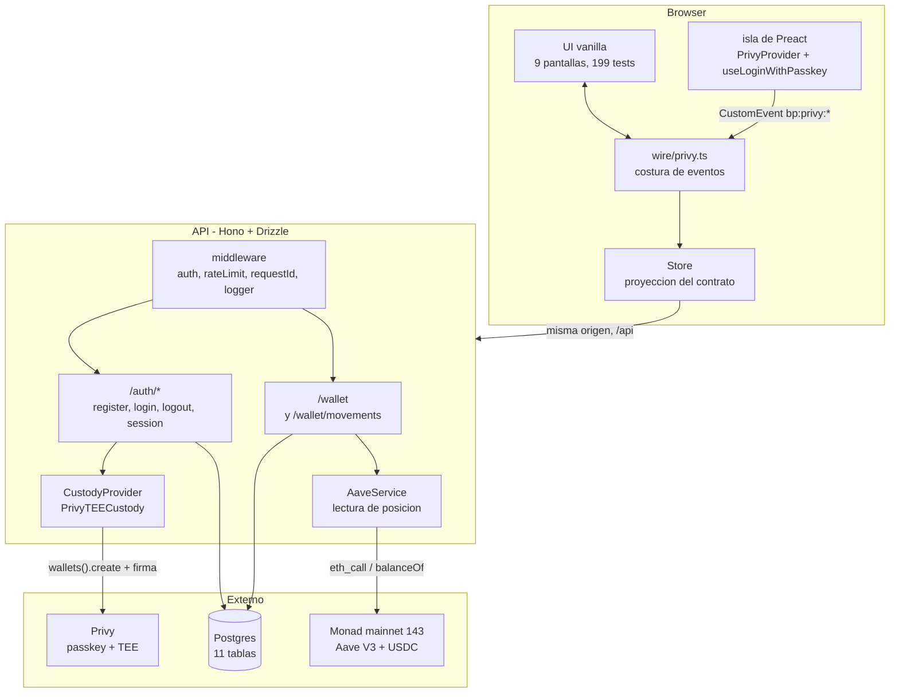
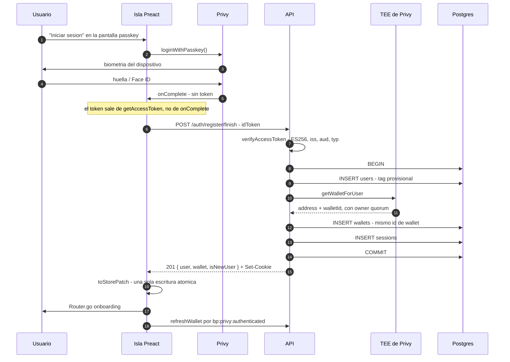
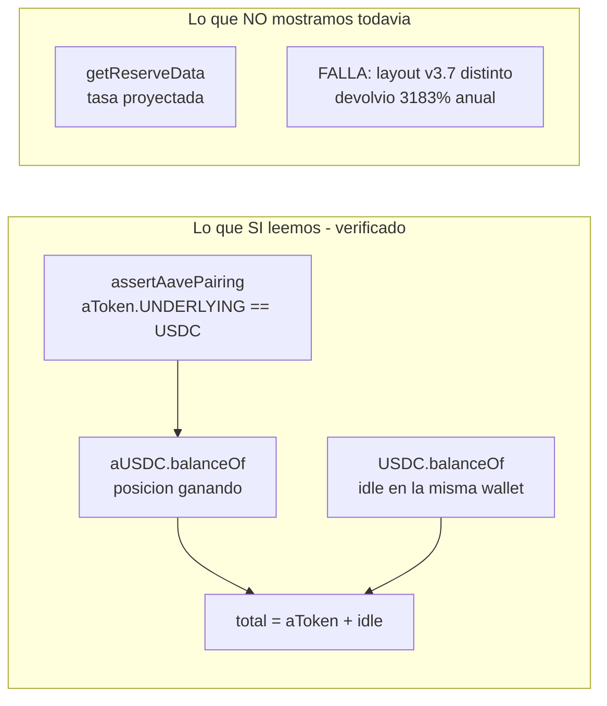
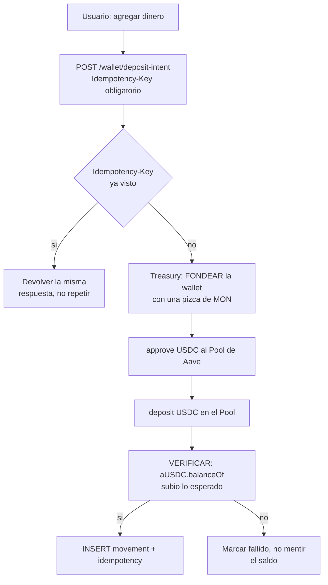
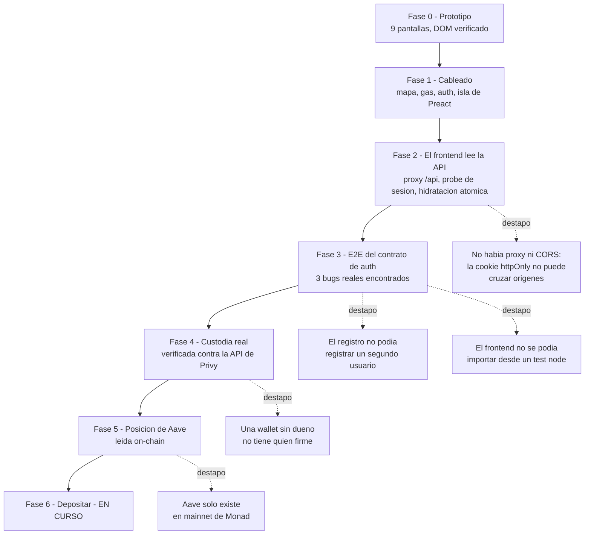
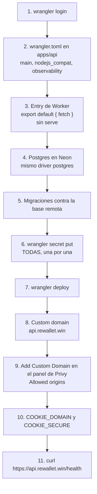

# ReWallet

**Monorepo de una wallet que borra la fricción de las cadenas.** El usuario entra con
su huella, deposita dólares, los deja ganando, y nunca ve una seed, ni una private
key, ni la palabra "gas", ni la palabra MON.

> Track: **Consumer Products & Payments** — Monad Metropolis. Cierre **13/10/2026**.
> El criterio del track, textual: *"a payments app that never mentions a blockchain to
> the person using it"*, ponderando *"a user's first five minutes"*. Esa frase es la
> brújula de todas las decisiones de este repo.

| | |
|---|---|
| Tests | **API 56/56 · Web 199/199** |
| Typecheck | **5/5 paquetes** |
| Registro real | `201` con wallet en la TEE de Privy ✅ |
| Firma desde el server | verificada criptográficamente ✅ |
| Yield | posición legible on-chain; tasa **todavía no** (ADR-003) |

---

## 1. Qué está construido y qué no

| Capa | Estado | Detalle |
|---|---|---|
| Passkey (WebAuthn) | ✅ | La isla de Preact monta, el prompt aparece. Requiere `localhost` y un dispositivo con autenticador. |
| Custodia (ADR-001) | ✅ | Wallet creada **desde nuestro server** en la TEE de Privy, con dueño en un key quorum. `createOnLogin` **apagado**. |
| Firma server-side | ✅ | `personal_sign` firmado por la TEE; el firmante recuperado es la wallet. |
| Sesión | ✅ | Cookie httpOnly `bp_session`. El frontend nunca ve el token. |
| Contrato front⇄back | ✅ | Un test de la API importa el mapper del frontend y le pasa la **respuesta real**. |
| Lectura de posición Aave | ✅ | `aUSDC.balanceOf` + `USDC.balanceOf`, con el pairing verificado on-chain. |
| Tasa de Aave | ❌ | `getReserveData` con layout adivinado dio **3183% anual**. No se muestra hasta tener ABI verificado. |
| Depositar en Aave | ❌ | Falta firmar `eth_sendTransaction` + idempotencia + treasury. |
| Contactos reales | ❌ | La ruta devuelve `{items: []}`. |
| Perfil al backend | ❌ | `PATCH /auth/profile` existe y es real; el frontend sigue mock. |
| Yield accrue | ❌ | Falta la lectura del accrue. |
| Deploy | ❌ | Ver §8. Todo el *groundwork* está. |
| Git | ❌ | **No hay repo.** El toplevel de git es el home del usuario. Sin rollback. |

---

## 2. Arquitectura



**La costura, en una frase:** la isla habla el idioma de Privy, el resto de la app
habla el idioma del `Store` y el `Router`, y se comunican **solo** por `CustomEvent`
en `window`. Por eso la isla se puede borrar sin tocar una pantalla.

---

## 3. Flujos

### 3.1 Registro de punta a punta (verificado)



Tres decisiones que no son obvias y cuestan plata si se tocan:

- **`onComplete` no trae token.** Trae `{user, isNewUser}`; el token sale de
  `getAccessToken()`. Asumir lo contrario manda `undefined` al backend.
- **El registro es una transacción.** El usuario se insertaba antes que la wallet, y
  una falla en el medio dejaba una cuenta sin wallet: `login/finish` respondía 500
  para siempre y la passkey quedaba atascada sin salida.
- **El tag es provisional y único.** Estaba hardcodeado a `@rewallet`, así que el
  segundo usuario moría en `users_tag_unique` con un 500 crudo de Drizzle.

### 3.2 Firma desde nuestro server (verificada)

```mermaid
flowchart LR
    A["Backend<br/>solicita eth_sendTransaction"] --> B["generateAuthorizationSignatures<br/>input canonico: version, method,<br/>url, body, headers"]
    B --> C["P-256 firma con la<br/>authorization key del server"]
    C --> D["privy-authorization-signature"]
    D --> E["POST api.privy.io/v1/wallets/{id}/rpc"]
    E --> F["TEE: 2 de 2 shares<br/>reconstruye la clave en memoria"]
    F --> G["firma, broadcast a Monad"]
    G --> H["leer aUSDC.balanceOf<br/>y comprobar"]
```



La clave privada **nunca sale de la TEE** y nunca estuvo en el browser. El server
solo aporta una firma de autorización.

### 3.3 Yield: lo que se lee y lo que no



**Decisión:** el rendimiento se muestra como *"tu saldo subió $0,42 porque el aUSDC
de tu wallet subió"*, que es dinero demostrable en el explorer, y no como un APY
proyectado que hoy no podemos leer confiablemente.

### 3.4 El camino del depósito (pendiente, es el siguiente)



Tres cosas antes de escribir esta transacción:

1. **Idempotencia primero.** Un doble clic o un reintento = depósito doble. La ruta
   ya tiene `requireIdempotencyKey()`.
2. **Treasury antes que paymaster.** En Monad el gas cuesta ~0,00002 MON. Fondear
   la wallet cuesta centavos de centavo. El paymaster es la respuesta correcta a
   escala, y hoy agrega una dependencia y un 7702 que en Monad está apagado por
   defecto.
3. **Verificar después, no confiar antes.** El único hecho que prueba el depósito es
   el `balanceOf`.

---

## 4. El camino que fuimos siguiendo

Esto no se construyó de una. El orden importa, y hubo tres momentos donde
descubrimos que lo que creíamos estaba mal.



**Los tres momentos que cambiaron el proyecto:**

1. **En la fase 2 apareció el bloqueador de la cookie.** La sesión es httpOnly, así
   que un front en `:5173` llamando a una API en `:3000` es imposible sin
   `SameSite=None` + CORS, que no anda en HTTP local. La respuesta fue **same-origin
   con proxy**, y de ahí salió que testnet tampoco servía: sin Aave, la mitad del
   producto no existe.

2. **En la fase 3, el E2E encontró tres bugs que ningún test individual veía.** Los
   tests de front stubean `fetch`; los del backend llaman la app Hono directo. Las
   dos mitades nunca se habían validado una contra la otra, y por eso ambas estaban
   en verde mientras el login real no podía funcionar. Para poder hacer ese test
   hubo que **extraer la mitad pura** de `wire/privy.ts` a `wire/session-envelope.ts`:
   el módulo viejo importaba el Router, que toca `window` al cargar.

3. **En la fase 5, la tasa de Aave nos dio 3183% anual.** Un índice mal puesto en un
   tuple no da error: da un número plausible. La regla que salió de ahí es la más
   importante del repo: **un número de rendimiento que no podemos verificar no se
   muestra.**

---

## 5. Hechos verificados (no copias de internet)

Todo lo de esta tabla se comprobó contra la RPC de Monad o contra la API de Privy.

| Dato | Valor | Cómo se verificó |
|---|---|---|
| USDC en Monad | `0x754704Bc059F8C67012fEd69BC8A327a5aafb603` | `symbol()` y `decimals()` on-chain |
| Aave V3 Pool | `0x69a5F9AD4f96ebf0a0C792dD42a01cC5C0102fef` | Address book **y** `getPool()` en el provider |
| aToken de USDC | `0x35a73BAcb179d3740395A3ceCc87FF2e581d6042` | `UNDERLYING_ASSET_ADDRESS()` devuelve el USDC de arriba |
| Aave en Monad | **solo mainnet** | el PoolAddressesProvider no tiene bytecode en testnet |
| Tasa de supply | 5,3–6,1% total (3,6% base + ~2% Merkl) | Aavescan / DefiLlama. **No** leída del contrato todavía. |
| Gas en Monad | ~0,00002 MON por tx | transacción real vista en el explorer |

---

## 6. Trampas que nos costaron tiempo

Documentadas porque volver a caer en ellas cuesta un día.

| Trampa | Síntoma | regla |
|---|---|---|
| Servir en `127.0.0.1` | `SecurityError: 127.0.0.1 is an invalid domain` | Privy valida el **origin**. Servir y abrir en `localhost`. |
| Linux sin platform authenticator | Privy ofrece un QR que requiere una passkey que no existe | En el **teléfono** no hace falta: el teléfono tiene lector. |
| `client.wallets` es una factory | `create is not a function`, **sin error de tipos** | La llamada real es `client.wallets().create(...)`. |
| Token sin `typ: 'JWT'` | 401 siendo que firma, issuer, audience y exp están bien | `verifyAccessToken` pasa `typ` a `jwtVerify`. |
| `external_id` con `:` | 400 `invalid_string` nombrando el path | Privy valida el campo contra un regex. |
| Wallet sin `owner_id` | se crea, pero **nadie puede firmar** | El key quorum es el dueño. Sin eso no hay depósito. |
| Input de autorización incompleto | 401 con firma generada | Exige `version: 1` y `headers['privy-app-id']`. |
| `prepareRequest` no exportado | `SyntaxError` al importar | Usar `generateAuthorizationSignatures`. |
| `z.string().optional()` en `.env` | la API no arranca con `VAR=` vacío | dotenv lo pasa como `''`, que zod ve como presente. Existe `optionalString`. |
| `getReserveData` por posición | 3183% anual, sin error | Un tuple mal leído no falla. No mostrar lo que no se puede verificar. |
| Piso de 10 MON | las txs revierten en EOAs delegadas | Solo aplica a EIP-7702. Evitarlo nos ahorra el costo. |
| EIP-7702 en Monad | `-32602 EIP-7702 is disabled` | Deshabilitado por defecto para cada team en Alchemy. |
| `nanoid` en un tag | test flaky 4 de 7 corridas | El alfabeto tiene `-` y `_`, y el normalizador los borra: la longitud varía. |

---

## 7. Decisiones

Viven en `../odd/decisions/` y en `../odd/tasks/`.

| Doc | Qué decide |
|---|---|
| `adr-001-custodia.md` | Wallet TEE creada desde el server, `createOnLogin` apagado, dueño 2-de-2 (passkey + authorization key) |
| `adr-002-alineacion-plan-original.md` | Qué del plan original se confirma, se corrige y se descarta (las "50+ wallets" salen del pitch) |
| `app-functional-ladder.md` | Los 6 peldaños de mock a funcional, con su estado |
| `wire-wallet-read.md` | La pasada 2: proxy, probe de sesión, hidratación atómica |
| `wire-privy-island-mount.md` | El montaje de la isla de Preact |

---

## 8. Deploy a Cloudflare Workers

Objetivo: `$0`, sin Docker, con `rewallet.win` ya comprado.

### 8.1 Correcciones al documento de contexto

`../deepseek_mermaid_20260927_661053.mermaid` es un buen plan **con cuatro cosas que
hay que corregir antes de ejecutarlo**:

| El documento dice | Realidad |
|---|---|
| `bestpath.app` | **`rewallet.win`** |
| Monad **testnet** 10143 | **mainnet 143** — Aave no existe en testnet |
| `@privy-io/server-auth` | **deprecado** → `@privy-io/node` |
| embedded wallet creada automáticamente | wallet **custodial creada por el server**, `createOnLogin` apagado |
| secrets: 8 variables | faltan **`PRIVY_WALLET_AUTH_PRIVATE_KEY`**, **`PRIVY_WALLET_OWNER_ID`**, `PRIVY_WALLET_AUTH_KEY_ID` |
| `export default app` | hoy `index.ts` usa `serve()`; hace falta una entry de Worker |
| policy engine, `middleware/idempotency.ts`, indexer con Durable Objects + D1 | **no existen**. El documento los da por hechos |

### 8.2 Lo que hay que hacer



**Los secrets, en orden.** Los marcados con ⚠️ no están en el documento original:

```bash
wrangler secret put DATABASE_URL                 # Neon
wrangler secret put PRIVY_APP_ID
wrangler secret put PRIVY_APP_SECRET
wrangler secret put PRIVY_VERIFICATION_JWKS
wrangler secret put PRIVY_WALLET_AUTH_PRIVATE_KEY   # la authorization key, base64 PKCS8
wrangler secret put PRIVY_WALLET_OWNER_ID           # el key quorum
wrangler secret put PRIVY_WALLET_AUTH_KEY_ID        # solo para logs
wrangler secret put SESSION_SECRET
```

**Vars** (van en `wrangler.toml`, no son secretos):

```toml
MONAD_CHAIN_ID = "143"
MONAD_RPC_URL = "https://rpc.monad.xyz"
MONAD_EXPLORER_URL = "https://monadscan.com"
GAS_PHASE = "mvp"
GAS_TESTNET_MODE = "false"
USDC_ADDRESS_MONAD = "0x754704Bc059F8C67012fEd69BC8A327a5aafb603"
AAVE_POOL_ADDRESS_MONAD = "0x69a5F9AD4f96ebf0a0C792dD42a01cC5C0102fef"
AAVE_ATOKEN_ADDRESS_MONAD = "0x35a73BAcb179d3740395A3ceCc87FF2e581d6042"
```

### 8.3 Antes de desplegar, dos cosas que solo funcionan en el dominio real

- **`COOKIE_DOMAIN=localhost` rompe la cookie** en cualquier otro dominio. En
  producción va vacía o `.rewallet.win`, y **`COOKIE_SECURE=true`**.
- **Rotar la authorization key.** La que hay en `.env` apareció en un chat de
  desarrollo. Hay que revocarla en el panel, emitir otra, y guardar la nueva
  **solo** como secret de Wrangler.

### 8.4 Restricciones del runtime que nos van a morder

`workerd` no es Node. Lo que ya sabemos que hay que revisar:

- **Sin filesystem.** El cursor del indexer no puede ir a un archivo.
- **Sin `child_process` ni timers largos.** El indexer va por cron trigger.
- **`nodejs_compat` es obligatorio** para `Buffer`, `crypto` y el driver `postgres`.
- **Límite de CPU** en el plan free: un `eth_getLogs` grande lo revienta. Por eso el
  indexer va paginado, no "traeme todo el rango".

---

## 9. Desarrollo local

```bash
cd "/home/lordbitcoin/Projects Web3/ReWALLET"
./dev.sh up
```

| Comando | Qué hace |
|---|---|
| `./dev.sh up` | instala, crea el `.env`, levanta Postgres, migra, siembra y arranca |
| `./dev.sh down` | detiene servidores y base |
| `./dev.sh reset` | borra el volumen y lo recrea |
| `./dev.sh check` | diagnóstico: node, pnpm, docker, tablas, env, servidores |
| `./dev.sh logs` | sigue los logs de la API |

> **Abrí siempre `http://localhost:5173`, nunca `127.0.0.1`.** No es preferencia:
> Privy rechaza la IP literal y el login muere antes de WebAuthn.

| Comando | Qué hace |
|---|---|
| `pnpm dev` | API en `:3000`, web en `:5173` |
| `pnpm test` | 199 web + 56 api |
| `pnpm typecheck` | `tsc --noEmit` en los 5 paquetes |
| `pnpm db:migrate` | aplica migraciones |

---

## 10. Reglas del repo

Estas no son sugerencias. Cada una existe porque romperla costó un bug.

- **La plata es `numeric(20,6)` y se maneja en unidades enteras.** Nunca float.
- **Todo POST que mueve plata exige `Idempotency-Key`.**
- **La sesión es una cookie httpOnly.** El store nunca recibe un campo con forma de
  sesión, y hay una auditoría que lo hace fallar si alguien lo intenta.
- **Los errores salen siempre como** `{ ok: false, error, message, code }`.
- **Nada hardcodeado.** Todo viene de env validado con Zod; el proceso se niega a
  arrancar con config inválida.
- **Un número que no se pudo verificar no se muestra.** La tasa de Aave es el
  ejemplo: mejor no tenerla que tenerla en 3183%.
- **Un 4xx de una API externa no prueba que nuestra parte esté bien.** El orden de
  validación importa: primero se valida el input, después la autorización.
- **`apps/api` y `packages/*` son `strict: true`, sin `any`.**

---

## 11. Documentos

| Path | Qué hay |
|---|---|
| `../odd/decisions/adr-001-custodia.md` | El modelo de propiedad de la wallet y por qué se decide ahora |
| `../odd/decisions/adr-002-alineacion-plan-original.md` | Alineación con el plan original, con evidencia |
| `../odd/tasks/app-functional-ladder.md` | Los 6 peldaños de mock a funcional |
| `../odd/tasks/wire-wallet-read.md` | La pasada 2, con sus decisiones |
| `../odd/tasks/wire-privy-island-mount.md` | El montaje de la isla |
| `../ReWallet_UI_UX_Design_System_v1.md` | El sistema de diseño |
| `apps/web/ENVIRONMENT.md` | Variables del frontend y la regla de `localhost` |
